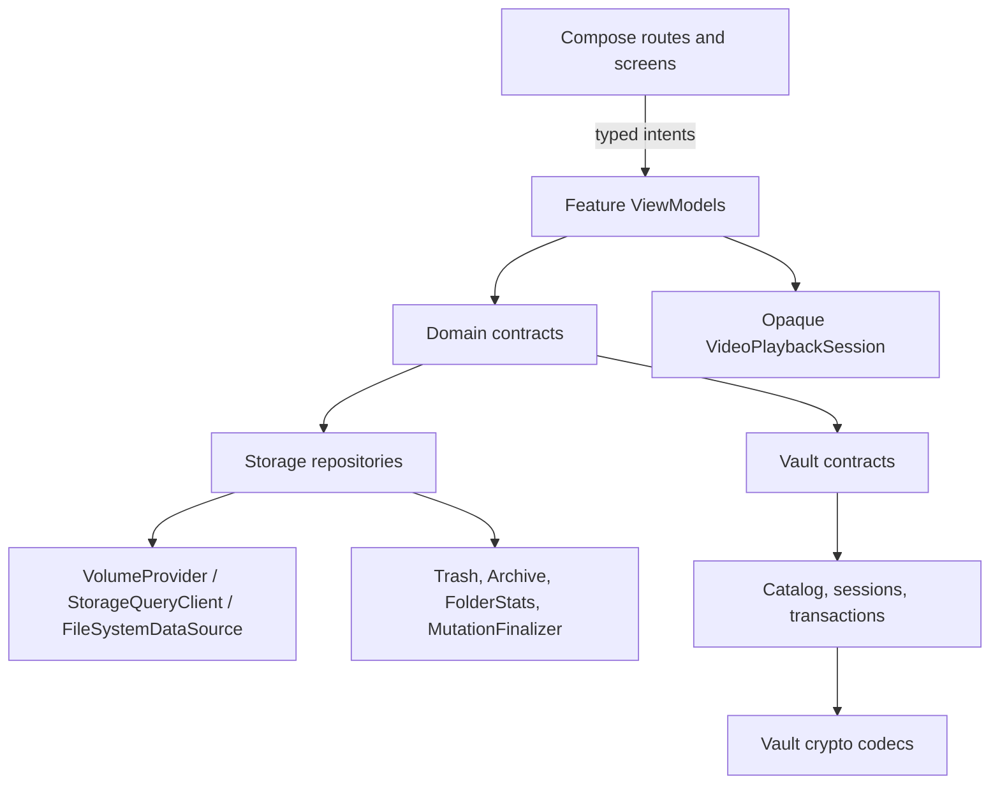

# Arcile Developer Guide

How Arcile is built, the rules the code follows, and how to verify and release it.

**Version:** 2.5.0 | **Last Updated:** 2026-11-08

---

## Contents

- [Overview](#overview)
- [Toolchain](#toolchain)
- [Modules](#modules)
- [App Startup and Navigation](#app-startup-and-navigation)
- [Storage](#storage)
- [OnlyFiles Vaults](#onlyfiles-vaults)
- [Media](#media)
- [Room Cache](#room-cache)
- [Archives and Trash](#archives-and-trash)
- [Plugins](#plugins)
- [UI System](#ui-system)
- [Rules the Code Follows](#rules-the-code-follows)
- [Testing](#testing)
- [Build and Release](#build-and-release)
- [Troubleshooting](#troubleshooting)
- [Maintenance](#maintenance)

---

## Overview

Arcile is a multi-module Android app: Compose UI, feature-owned ViewModels exposing `StateFlow`, Hilt for injection, and small domain contracts in front of the storage, vault, and operation layers.



Decisions that shape everything else:

- **No internet permission.** Everything happens on the device.
- **Features own their routes.** Each feature creates its ViewModel, collects state, owns its platform launchers, and emits neutral destinations. Only the app shell maps destinations to `AppRoutes`.
- **Features inject only the capabilities they use**: listing, mutation, search, analytics, trash, archive, volume, or clipboard contracts.
- **Long operations run in a foreground service** (copy, move, archive, extract, import) with journaled recovery.
- **Plugins are separate same-signer APKs** reached through explicit intents and read-only URI grants. Arcile never loads plugin code.
- **Vault keys never reach presentation code.** OnlyFiles talks to `core:vault:*` contracts only.

## Toolchain

| Area | Version |
|------|---------|
| Kotlin / KSP | 2.4.21 / 2.3.12 |
| Gradle / AGP | 9.8.2 / 9.5.0, daemon on JDK 21, bytecode target JVM 11 |
| SDK | compile and target 37, min 30 |
| Compose | BOM 2026.09.00, Material 3 1.5.0-beta02, Material 3 Adaptive 1.3.0, MaterialKolor 5.0.1 |
| Data | Room, DataStore Preferences, kotlinx.serialization |
| Media | Media3, Coil 3 (local fetchers only, no network module), ExifInterface |
| Archives | Commons Compress, Tukaani XZ, Zip4j |
| Crypto | Android Keystore, Bouncy Castle |
| Tests | JUnit 4, Robolectric, MockK, Turbine, ArchUnit, Espresso |

Versions live in `arcile-app/gradle/libs.versions.toml`.

## Modules

37 Gradle modules under `arcile-app/`:

```text
app/                      Activities, Hilt graph, app shell, route mapping
core/
  navigation/api/         Serializable AppRoutes
  operation/api/          Operation requests, progress, recovery contracts
  operation/android/      Foreground operation service, journal, importer, APK installer
  plugin/android/         Plugin discovery and compatibility checks
  presentation/           Shared reducers, search, clipboard, properties
  runtime/                ArcileDispatchers, logging, cancellation helpers
  storage/domain/         Storage contracts, models, path helpers (pure Kotlin)
  storage/data/           Repositories, Room, MediaStore, filesystem engines
  vault/domain|crypto|data  Vault contracts, codecs, catalog/transactions/recovery
  testing/, ui/testing/   Shared fakes and Compose test helpers
  ui/                     Design system, viewers, external-file and metadata adapters
feature/
  activitylog apk archive audio browser documents gallery home import onboarding
  onlyfiles plugins quickaccess recentfiles settings storagecleaner storageusage
  trash videoplayer
plugin-api/               Dependency-free plugin intent contract
plugin-ui/                Stateless Compose pieces shared with plugin APKs
```

Repository root: `docs/` is the website, `CHANGELOG.md` the full change history, `RELEASES.md` user-facing release notes, `TASKS.md` open work.

## App Startup and Navigation

1. `AppSessionTracker` tells a cold launcher start from a configuration recreation. A cold start replaces any restored stack with `AppRoutes.Main(initialPage = 0)` behind a neutral surface, so no other screen flashes.
2. `MainActivity` keeps the splash screen up while theme and onboarding preferences load (2-second fallback).
3. Onboarding asks for All Files Access and, on Android 13+, notifications. It completes on its own when access is already granted.
4. `ArcileAppShell` builds the typed graph. `MainShellCoordinator` owns the Home/Browser pager and restores Browser's location only when Browser is entered.

Routes are `@Serializable` classes in `AppRoutes.kt`. Each feature registers through `NavGraphBuilder.registerXRoute(...)`. Match destinations with `hasRoute<T>()` or `toRoute<T>()`, never with class names: R8 renames classes, while serial names are fixed at compile time.

Back from a Browser handoff closes local Browser UI first, then walks folder and archive history, then pops the previous app route, so `a > b > c` unwinds as `c > b > a`. Detail screens slide horizontally with a slight scale; utility screens rise from the bottom. With Reduce Motion on, every transition becomes an instant crossfade.

## Storage

**Scopes.** `StorageScope` is `AllStorage`, `Volume(volumeId)`, `Path(volumeId, path)`, or `Category(volumeId, category)`.

**Volumes** are permanent (internal, SD card: counted in analytics, deletions go to Trash) or temporary (USB OTG and unknown mounts: excluded from totals, deletions are permanent). Users can reclassify volumes; `VolumeProvider` applies the choice.

**Services behind the repositories:**

| Service | Job |
|---------|-----|
| `VolumeProvider` | Mounted volumes and their classification |
| `StorageQueryClient` | MediaStore queries for files, recents, categories |
| `DefaultFileSystemDataSource` | Direct listing and mutations |
| `FolderStatsStore` | Background folder sizes, cancelled when you leave a folder |
| `TrashManager` / `ArchiveManager` | Trash and archives |
| `ExternalFileAccessHelper` | Staged handoffs to other apps |
| `MutationFinalizer` | Media scanner and cache updates after a change |

**Conflicts are resolved before work starts.** A top-level name check finds collisions, the user picks Replace, Keep Both, or Skip, and `FileConflictNameGenerator` produces names like `image (1).png`.

**Transfers are verified.** Replacements are staged and verified, with the original kept as a backup until publication. Once backup cleanup has started, a failure keeps the verified replacement and the pending journal record, because the backup may be incomplete. Cross-filesystem moves verify the destination before deleting the source. Recovery rechecks identities and contents first, so files changed since the operation survive.

## OnlyFiles Vaults

OnlyFiles is an encrypted virtual filesystem, not a hidden folder.

| Module | Owns |
|--------|------|
| `core:vault:domain` | Opaque IDs, contracts, paging, health results, typed failures |
| `core:vault:crypto` | Header and manifest codecs, key derivation and wrapping, authenticated streams |
| `core:vault:data` | Catalog, sessions, transactions, recovery, import/export, grants, encrypted thumbnails |
| `feature:onlyfiles` | Vault library, browser, viewers, biometric prompt, transfers, administration |

The persisted format is specified in [`arcile-app/docs/ONLYFILES_FORMAT_AND_SECURITY.md`](arcile-app/docs/ONLYFILES_FORMAT_AND_SECURITY.md). That document and the golden-vector tests are the format contract: never change persisted bytes implicitly.

**Sessions**
- Routes, saved state, and logs carry opaque IDs only, never vault paths, object names, or keys.
- Unlocking creates an in-memory mount. Background locking is immediate by default (optional 30 s, 1 min, or 5 min grace); screen-off locking ignores the grace; process death never restores keys.
- A privacy curtain hides content until a pending lock completes. Transfers and external grants hold their own bounded leases.
- Passwords are always masked text. The numeric keyboard is only an input preference.

**Mutations**
- A per-vault lock serializes manifest changes. Cross-vault transfers take locks in UUID order.
- Each change stages encrypted objects and a new manifest, verifies them, publishes atomically, then deletes superseded objects. Startup recovery finishes or rolls back interrupted transactions.
- Manifests are paged and authenticated. Traverse trees iteratively and stream objects, so huge folders and deep trees never exhaust memory or the stack.

**Plaintext leaves only on purpose**
- Export and move-out write through staged siblings, verify, and publish. Move-out deletes encrypted sources only after every destination is committed.
- Open/share uses short-lived read-only content URI grants that close on expiry, lock, or process cleanup.
- In-app viewing streams through random-access adapters, with no plaintext cache. Thumbnails are encrypted at rest.

**Flow.** Library → authenticate → mounted browser → lock. Imports and exports use Arcile's own file and destination browsers; do not add `ACTION_OPEN_DOCUMENT_TREE` or a `DocumentsProvider` for these flows. Content-URI reading exists only for real external-provider imports.

## Media

**Video.** `feature:videoplayer` owns one Media3 player for every source. Producers register a `VideoPlaybackSession` and navigate with `AppRoutes.VideoViewer(sessionToken)`; the token is process-local, so routes never carry paths, URIs, or queues. Removing a session runs its cleanup callback, and an expired token fails into a recoverable screen. `VideoViewerActivity` handles `ACTION_VIEW` from other apps; its notification reopens that viewer, while in-app playback returns to the launcher activity. Feature modules never depend on `feature:videoplayer`.

**Audio.** `feature:audio` owns the Audio library (Songs, Folders, Albums, Artists, Playlists) and `AudioPlaybackService`.
- Playlists live in `audio_playlists.json`; favorites, play counts, and history in `arcile_audio.db`.
- The queue and the playback position are saved separately, so position saves never rewrite the queue. Position updates run only while a player screen is visible.
- Browser and OnlyFiles share the player UI in `core:ui`. The OnlyFiles player is bound to the unlocked session.
- Tag and artwork edits verify their output and keep a recovery copy.

## Room Cache

`ArcileDatabase` (`arcile-cache.db`, version 2) caches what would otherwise need repeated disk scans. It runs with multi-instance invalidation because viewer processes read it too.

| Table | Holds |
|-------|-------|
| `folder_stats` | Folder item counts and sizes |
| `storage_nodes` | Listed files with MediaStore identity and dimensions |
| `category_summaries` | Per-scope category totals |
| `thumbnail_entries` / `thumbnail_variants` | Thumbnail successes, failures, and size buckets |
| Recent files, storage usage, cleaner snapshots | Last results shown while fresh data loads |

Schemas are exported to `core/storage/data/schemas/`. A version bump needs the new schema JSON, a migration or scoped `fallbackToDestructiveMigrationFrom(...)` test, and a changelog line saying whether cached rows survive.

## Archives and Trash

**Archives.** Browse, create, and extract ZIP (AES passwords through Zip4j), 7z (with passwords), TAR, TAR.GZ, TAR.BZ2, and TAR.XZ. GZ, BZ2, and XZ are browse and extract only; RAR is recognized but disabled. Filename encodings: UTF-8, CP437, Windows-1252, Shift JIS, GBK, Big5. Every entry passes `PathSafety.isArchiveEntrySafe` before extraction (no absolute paths, no `..`). Creation pre-scans at most 2,048 entries or 512 MB.

**Trash.** Permanent volumes keep trashed files in `.arcile/.trash` at the volume root, with JSON sidecars in `.arcile/.metadata` and a `.nomedia` file so galleries ignore them. The public location survives reinstalling. If an original folder no longer exists, restore asks for a destination; conflicts use Keep Both.

## Plugins

Plugins are separate APKs signed with Arcile's certificate. Arcile discovers and launches them through intents and never loads their code, resources, or native libraries.

| Module | Owns |
|--------|------|
| `plugin-api` | Contract constants, API version, metadata models. No runtime dependencies. |
| `plugin-ui` | Stateless Compose viewer pieces. No app storage, features, or Hilt. |
| `core:plugin:android` | Discovery, signature and API checks |
| `feature:plugins` | Plugin management screen |

Contract version: `PluginContract.PLUGIN_API_VERSION = 1`.

**Registration.** An exported activity handles `dev.qtremors.arcile.plugin.REGISTER` and declares:

| Metadata | Value |
|----------|-------|
| `dev.qtremors.arcile.plugin.API_VERSION` | Integer API version |
| `dev.qtremors.arcile.plugin.NAME` | Display name or string resource |
| `dev.qtremors.arcile.plugin.SUPPORTED_MIME_TYPES` | Lowercase, comma-separated; wildcards like `image/*` allowed |
| `dev.qtremors.arcile.plugin.SUPPORTED_EXTENSIONS` | Lowercase, comma-separated, no dots |
| `dev.qtremors.arcile.plugin.HOMEPAGE` | Optional URL |

The plugin's version comes from `PackageInfo.versionName` and `longVersionCode`; don't repeat it in metadata.

**Launch.** Arcile starts the activity explicitly with action `dev.qtremors.arcile.plugin.VIEW_FILE`, a `content://` data URI with its MIME type, `FLAG_GRANT_READ_URI_PERMISSION`, the same URI in `ClipData`, and these extras:

| Extra | Type |
|-------|------|
| `dev.qtremors.arcile.plugin.extra.FILE_URI` | `Uri` (intent data stays authoritative) |
| `dev.qtremors.arcile.plugin.extra.FILE_NAME` | `String` display name |
| `dev.qtremors.arcile.plugin.extra.MIME_TYPE` | `String` normalized MIME type |

**Compatibility.** `PluginManager` rejects disabled or non-exported activities, malformed metadata, and other signers. A plugin is launchable only when its API version matches exactly. Matching prefers exact MIME, then extension, then MIME wildcard. Files reach plugins only through Arcile's read-only `ExternalFileAccessProvider`.

```xml
<activity android:name=".ViewerActivity" android:exported="true">
    <intent-filter>
        <action android:name="dev.qtremors.arcile.plugin.REGISTER" />
        <category android:name="android.intent.category.DEFAULT" />
    </intent-filter>
    <meta-data android:name="dev.qtremors.arcile.plugin.API_VERSION" android:value="1" />
    <meta-data android:name="dev.qtremors.arcile.plugin.NAME" android:value="@string/plugin_name" />
    <meta-data android:name="dev.qtremors.arcile.plugin.SUPPORTED_MIME_TYPES" android:value="model/stl" />
    <meta-data android:name="dev.qtremors.arcile.plugin.SUPPORTED_EXTENSIONS" android:value="stl" />
</activity>
```

**Writing one.** Give it its own application ID (for example `dev.qtremors.arcile.plugin.stl`), depend on `:plugin-api` (and `:plugin-ui` if needed), and expose only the registration activity: no `MAIN`, `LAUNCHER`, or generic `ACTION_VIEW`. Validate the action, `content` scheme, type, and readability before rendering, and keep heavy codecs inside the plugin. Add it to `PluginManager.catalog` only if Arcile should advertise it while it's missing. Before publishing, check matching certificates with `apksigner verify --print-certs`, then test the missing and incompatible states, opening a real file, share/open-with, and Back.

## UI System

Material 3 Expressive with Arcile's own theme layer in `core:ui`.

- **Themes:** Light, Dark, System, and OLED (pure black surfaces), plus Dracula and Tokyo Night presets and a Custom mode with user colors. Accents come from the wallpaper (Android 12+), monochrome, or preset seeds; optional harmonization blends category colors into the scheme.
- **Composition locals:** `LocalCategoryColors`, `LocalSemanticColors`, `LocalSpacing`, `LocalHapticsEnabled`, `LocalReducedMotionEnabled`, and the filename display locals.
- **Motion:** springs are slightly under-damped (`dampingRatio = 0.75f`). Animated sizes and paddings are clamped to zero or more so overshoot can't produce negative layout values. Every animation honours Reduce Motion.
- **Switches:** always `ExpressiveSwitch`, never the plain Material `Switch` (an architecture test enforces this). In a toggle row, pass `onCheckedChange = null` and make the row toggleable.
- **Typography:** use the semantic styles in `Type.kt` (`filename`, `fileMetadata`, `pathBreadcrumb`, `storageMetric`, `sectionHeader`, `dangerLabel`, and the bold helpers) instead of raw sizes.
- **Shared building blocks:** `ArcileScreenScaffold`, shared top and search bars, file rows and grids, `SplitButtonGroup` for selection actions, `ExpandableFabMenu`, the floating navigation bar, and fast scrollbars with date pills. A new screen, including a secure one, uses these before inventing its own.
- **Hidden files** (leading dot) render dimmed and italic. Scroll positions survive returning from viewers.
- **Utilities:** `ArcileUtilityCatalog` is the single list behind Tools and Home shortcuts, and only finished features belong in it. `HomeAndUtilityPreferencesStore` keeps the user's order, drops unknown IDs, and appends new sections without reordering existing ones. Adding a utility means its route, catalog entry, strings, and tests in the same change.
- **Text editor:** documents and drafts are capped at 4 MiB, undo history at 8 MiB and 50 entries, all kept out of saved-state bundles. Local saves stage, sync, and atomically replace the file without reading it back. Provider saves write a recovery draft first and read the result back once.

## Rules the Code Follows

`ArchitectureBoundaryTest` enforces most of these:

1. Features never depend on other features. The app consumes only route registration and destination contracts from them.
2. Feature ViewModels and composables never touch `Context`, `Dispatchers.IO`, concrete storage classes, or filesystem checks (existence, permissions, traversal, canonical paths). Data services decide and return typed results.
3. Data layers take threads from injected `ArcileDispatchers`, or `ArcileDispatchers.Standard` outside Hilt, never from hardcoded `Dispatchers.IO`.
4. UI strings live in `strings.xml`. Hardcoded UI text fails the build's tests.
5. A controller mutates only its own state; cross-controller changes go through the owning coordinator.
6. Production files stay at or under 700 lines, ViewModels under 500, and public composables at 15 parameters or fewer. Files that were already larger are capped at their current size and must not grow.
7. Coroutine code uses `runCatchingCancellable` or rethrows `CancellationException`; repositories return `Result<T>` with typed exceptions such as `DestinationRequiredException`.
8. Vault mutations use transactions, recovery, authenticated manifests, bounded sessions, reader leases, and iterative traversal. Nothing bypasses those contracts.
9. Player routes carry only session tokens, and every source adapter releases its files, descriptors, grants, and leases.
10. Feature-library manifests and resources never reference app-module themes or drawables.

## Testing

```bash
# Everything that runs on the JVM (unit and Robolectric)
./gradlew test testDebugUnitTest

# One module while iterating (pure Kotlin modules use `test`)
./gradlew :feature:browser:testDebugUnitTest

# Architecture rules only
./gradlew :app:testDebugUnitTest --tests dev.qtremors.arcile.ArchitectureBoundaryTest

# Lint
./gradlew :app:lintDebug

# Release gate
./gradlew testDebugUnitTest lintDebug assembleDebug assembleRelease

# Instrumented tests (needs a device or emulator)
./gradlew :app:connectedDebugAndroidTest :feature:quickaccess:connectedDebugAndroidTest
```

Run affected modules while working and the full suite at release milestones. Robolectric tests target SDK 34 or 35, below compile SDK 37. Vault changes need golden vectors, recovery, deep-tree, cancellation, and large-manifest tests. Player changes need source-adapter, session-lifecycle, and queue tests. Always test cancellation and removable-storage loss, not just success.

## Build and Release

Run from `arcile-app/` with JDK 21 and Android SDK 37 (`gradlew.bat` on Windows). Builds run in parallel with the build cache and configuration cache on (`gradle.properties`).

```bash
./gradlew :app:assembleDebug     # app/build/outputs/apk/debug/Arcile-2.5.0-debug.apk
./gradlew :app:assembleRelease   # app/build/outputs/apk/release/Arcile-2.5.0.apk
```

**Signing** reads `signing.properties`, falling back to `local.properties`. Never commit either file or a keystore.

```properties
signing.storeFile=/absolute/path/to/release.jks
signing.storePassword=...
signing.keyAlias=...
signing.keyPassword=...
```

**Google Play internal testing** builds a separate bundle with application ID `play.qtremors.arcile`:

```bash
./gradlew :app:bundleRelease -Parcile.play=true   # app/build/outputs/bundle/release/Arcile-2.5.0.aab
```

**Shrinking.** Release builds use R8 with resource shrinking. `app/proguard-rules.pro` holds only `-dontwarn` lines and line-number attributes; kotlinx.serialization, Hilt, and Navigation bring their own rules. Add a keep rule only for code reached by reflection, and smoke-test a release build after changing rules.

**Compose reports** are off by default. Add `-Parcile.composeReports=true` to write stability reports under each module's `build/compose_compiler/`.

**Permissions.** `MANAGE_EXTERNAL_STORAGE` (a file manager), `POST_NOTIFICATIONS`, foreground service (data sync and media playback), `REQUEST_INSTALL_PACKAGES` (APK installer), `QUERY_ALL_PACKAGES` (installed versions for any APK and app icons for `Android/data` folders), and `USE_BIOMETRIC` from OnlyFiles. Legacy storage permissions apply only to API 29 and below. There is no `INTERNET` permission.

**Backups.** `backup_rules.xml` (Android 11) and `data_extraction_rules.xml` (Android 12+) exclude keys, journals, staging, the Room cache, and all DataStore files, and must list the same paths (`BackupRulesTest` checks this). Settings move between devices through Arcile's own preferences backup.

**Website.** `docs/` is served by GitHub Pages as plain HTML, CSS, and JavaScript, with no build step and no third-party scripts, styles, or fonts. Colors are CSS variables at the top of `styles.css`. Icons are an inline SVG sprite in `index.html` (`<use href="#i-name"/>`) copied from Lucide and Simple Icons; add a new one as another `<symbol>`. The Outfit heading font is self-hosted in `docs/assets/fonts/` with its license. Screenshots live in `docs/Screenshots/` as lossless WebP, and the hero slideshow reads its screens from the `#showcase-screens` list in `index.html`.

## Troubleshooting

- **Onboarding loops:** check that the DataStore load in `MainActivity` finishes inside its 2-second timeout.
- **New files don't appear:** the mutation path must run `MutationFinalizer`.
- **OnlyFiles stays locked or unavailable:** check biometric capability, the session timeout, portable-volume identity, and the vault's health result. Never work around it by reading vault storage directly.
- **Interrupted vault transfer:** reopen the vault to run recovery, then read the health result before retrying. Don't delete staging or recovery data that belongs to a live operation.
- **Backup cleanup failed after a replacement:** keep the verified destination and the pending record; the original backup may be incomplete.
- **Video token expired:** expected after process death. Reopen the video from its source.
- **Vault video stops after locking:** expected; the reader lease closed with the session.
- **Release build crashes but debug doesn't:** look for code reaching classes by name (`::class.qualifiedName`, `Class.forName`) and use serializers or explicit references instead of adding keep rules.

## Maintenance

- Every user-visible change gets a line in `CHANGELOG.md` under the current version. Leave out intermediate refactors.
- Bump versions only when asked. `versionCode` is the version without dots (`2.5.0` → `250`).
- Changing the vault format means updating the format specification and compatibility tests together. Never reuse an authenticated-data domain or reinterpret an existing version.
- Copy portable vaults only while locked; a live multi-file copy isn't an atomic snapshot.
- Treat the architecture rules as guardrails, not a reason for speculative abstraction.

---

Arcile is a solo project. Forks for personal use are welcome under the license; pull requests are not accepted. Report bugs and ideas on the [issue tracker](https://github.com/qtremors/arcile/issues).

<p align="center"><a href="README.md">Back to README</a></p>
